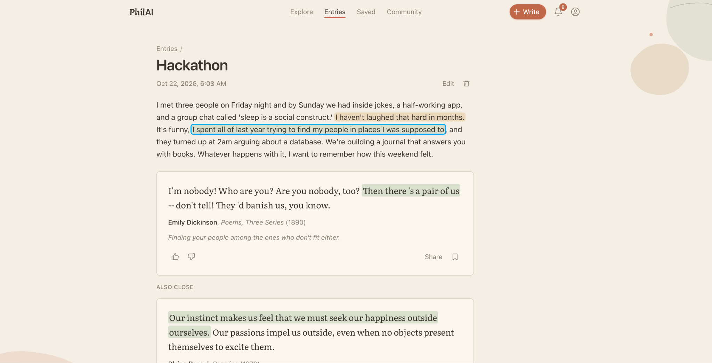
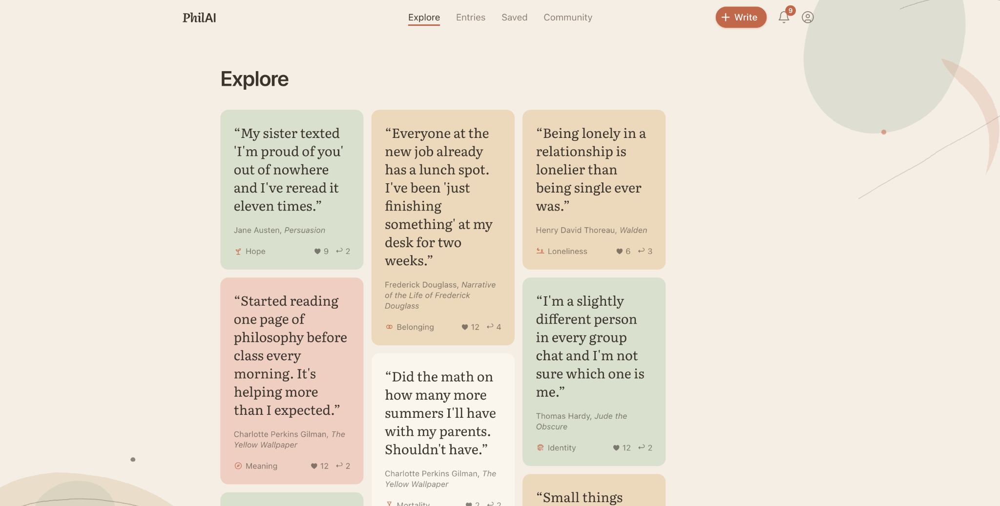
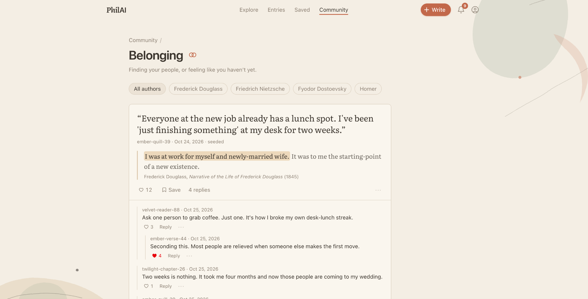
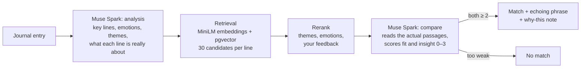

<div align="center">

# PhilAI

**A journal that answers you with books.**

Write about your day. PhilAI finds the lines that matter and links each one to a passage from public-domain literature: Dickinson, Marcus Aurelius, Brontë, Pascal. Then, if you want, you can talk about it with strangers who felt the same thing, anonymously.

[**Try it live → philai.vercel.app**](https://philai.vercel.app)

Built with **Meta Muse Spark** and **Muse voice transcription** · Next.js · Supabase · pgvector



</div>

## Why

Journaling apps either say nothing back, or reply with a chatbot's generic encouragement. But almost anything you could feel at 2am has already been written down, often beautifully, by someone a hundred years ago. PhilAI points you to the passage that was written for the line you just wrote. It doesn't summarize or advise. It hands you a book.

Reading something that names your feeling makes you want to talk about it, so every theme also has a forum where you can share a passage and the line it answered, with no names attached.

## What it does

<table>
<tr>
<td width="50%"></td>
<td width="50%"></td>
</tr>
<tr>
<td><b>Explore:</b> passages, authors and community posts to browse</td>
<td><b>Community:</b> one forum per theme, with a fresh alias in every thread</td>
</tr>
</table>

- **Write or speak.** Type an entry, or dictate it. Audio goes to Muse transcription and is thrown away.
- **Line-level matches.** PhilAI picks up to three key lines in your entry and highlights each one, along with the exact phrase in the passage that echoes it. A one-line note explains the connection.
- **"Also close."** Each match comes with runner-ups from other authors, each taking a different angle on the line.
- **It can say "no match."** If nothing in the library really fits, PhilAI shows nothing instead of a weak passage.
- **It learns your taste.** "Spoke to me", "Not for me" and saves shift which authors you see in later matches.
- **Saved library and author pages.** Keep passages, and browse everything the library holds by one author.
- **Anonymous forums.** 16 theme rooms (grief, belonging, ambition, regret…). Threaded replies, likes, and notifications.
- **Safe sharing.** Before you post, PhilAI catches names, schools, places, emails and phone numbers so you can take them out. Posts are moderated, and three reports hide anything until it's reviewed.
- **Crisis care.** If an entry suggests self-harm or passive ideation, the page shows the 988 Suicide & Crisis Lifeline and locks sharing for that entry.

## How matching works



1. **Analyze.** One Muse Spark call reads the entry and returns its key lines (quoted exactly), emotions from GoEmotions' 28 labels, themes, and a short reading of what each line means. A risk check runs here too.
2. **Retrieve.** Each line, plus that reading, is embedded with `all-MiniLM-L6-v2`. The model runs in-process through transformers.js, so embedding needs no API call. pgvector returns the 30 closest passages.
3. **Shortlist.** Theme and emotion overlap and your own feedback narrow the 30 down to 10.
4. **Compare.** One Muse Spark call per line reads the shortlisted passages and scores *fit* (is this about the same thing?) and *insight* (does it show the writer something new?). A passage has to score at least 2 on both to be shown.
5. **Verify.** Every highlighted line and phrase is checked against the original text character by character before it's stored, so a highlight can't show text the model made up.

More detail: [docs/insight-matching.md](docs/insight-matching.md) and [docs/richer-matching.md](docs/richer-matching.md).

## How we use Meta Muse

| Muse model | Used for |
|---|---|
| `muse-spark-1.3` (falls back to 1.2, 1.1) | Entry analysis, passage comparison and explanations, tagging the library, scrubbing personal details, moderation |
| `muse-voice-transcribe-1.0` | Voice journaling |

All calls use **Standard mode**: per Meta's docs, *"your content is not used to train Meta models."* PhilAI stores no audio. If every Spark id is down, a single call can fall back to OpenAI, but only when `OPENAI_API_KEY` is set.

## The library

56 public-domain works by 44 authors (published 1930 or earlier, from Project Gutenberg), listed in [data/sources.json](data/sources.json). The pipeline in [scripts/library/](scripts/library/) downloads the texts and cuts them into 1–4 sentence passages. Muse Spark then tags each passage with emotions, themes, a plain-English summary and a quality score. Passages rated 4 or higher are embedded and loaded. A curated set of passages also has editorial notes on the situations and tensions they speak to.

## Privacy

- **Anonymous to other users.** Your email is used only for login and is never returned by any API. Other people see a random handle, and a new alias in every forum thread.
- **Posts aren't linked to entries.** Sharing copies the passage and the line you chose. Nothing points back to your journal.
- **Row-level security everywhere.** Entries, matches and your saved passages can only be read by you. `user_id` is withheld from forum rows at the column level.
- **Delete means delete.** Deleting your account cascades to everything you've written.

## Tech stack

| | |
|---|---|
| App | Next.js 15 (App Router), React 19, TypeScript, Tailwind CSS 4 |
| Data | Supabase: Postgres, pgvector, Auth, row-level security |
| AI | Meta Muse Spark (text), Muse voice transcription, `all-MiniLM-L6-v2` via transformers.js (embeddings) |
| Hosting | Vercel |

## Run it locally

You'll need Node 20+, a Supabase project, and Muse API keys.

```bash
npm install
cp .env.example .env.local      # add Supabase and Muse keys
```

1. Apply the migrations in [supabase/migrations/](supabase/migrations/) in order, using the Supabase SQL editor or `supabase db push`.
2. Build the passage library (see [docs/DEVELOPMENT.md](docs/DEVELOPMENT.md#library-and-matching-teammate-track)), or leave `NEXT_PUBLIC_MATCH_MODE=mock` to try the UI with sample matches.
3. `npm run dev` and open http://localhost:3000.

Offline tests for the matcher (no credentials needed):

```bash
npm run test:matching
```

## Repository map

```
src/app/            Pages (Write, Entries, Explore, Saved, Community) and API routes
src/lib/            Matching pipeline, Muse client, embeddings, moderation, Supabase clients
supabase/           Database schema and RPCs, as migrations
scripts/library/    Build the passage library from Project Gutenberg
scripts/            Evaluation, smoke tests and seed data
data/               Source list and the tagged passage library
shared/             Shared vocabularies (themes, emotions) and API mocks
docs/               Development notes, matching design, evaluation results
```

## Team

Built in a weekend by **Sebastian Le** ([sebgle](https://github.com/sebgle)), who built the app and community, and **Emir Durakovic** ([emirdur](https://github.com/emirdur)), who built the passage library, matching and Muse integration.

## License

[MIT](LICENSE). The literary passages are in the public domain.
